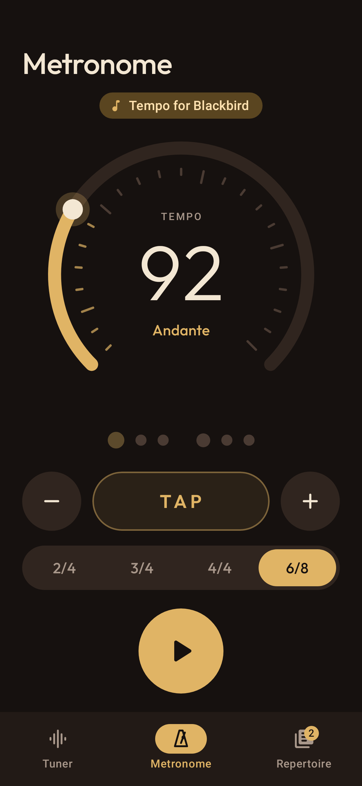
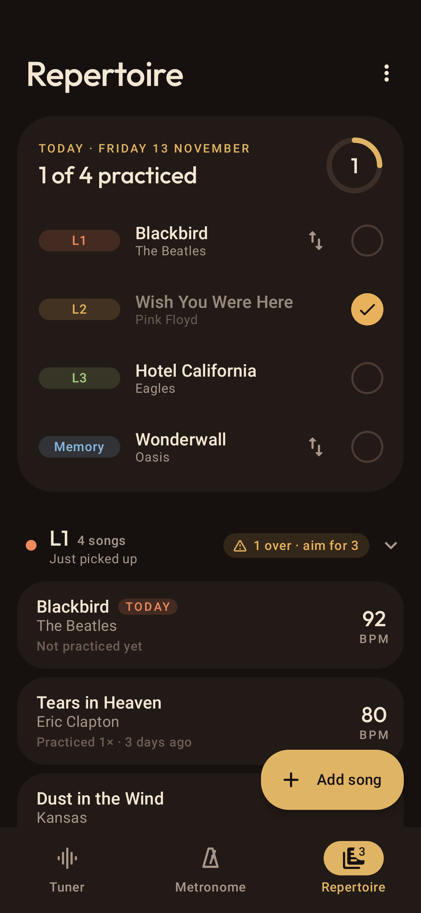

# Fretwise

A guitar practice app for Android: a tuner that detects which string you're playing, a metronome, and a
repertoire that plans one song from each learning level every day.

<p>
  
  
  
</p>

## Tuner

- **Detection:** McLeod Pitch Method (normalized autocorrelation via FFT), with the period refined over several repetitions for sub-cent precision. Input is low-passed per instrument to cut mic hiss. See `audio/PitchDetector.kt`.
- **Stability:** adaptive noise gate, median + exponential smoothing, string auto-detection with hysteresis, and a string counts as tuned once it holds within ±4 cents for 0.3 s (the needle stays green until 6 cents off, so it doesn't flicker at the edge). See `TunerTracker.kt`.
- **Instruments:** guitar (11 tunings), 7-string, bass (4/5-string), ukulele, chromatic. Adjustable A4 reference.

## Metronome

30–250 BPM from a rotary dial (haptic tick per BPM), ± buttons (hold to repeat) or tap tempo; 2/4, 3/4, 4/4, 6/8
with an accented downbeat. Clicks are mixed into one continuous PCM stream, so timing is sample-accurate, and the beat
lights follow the audio playhead. It keeps playing on the Repertoire tab, and stops on the Tuner tab (the clicks would
confuse pitch detection) or when the app leaves the screen. See `metronome/`.

## Repertoire

Songs move through four levels by hand: **L1** (just picked up) → **L2** → **L3** → **Memory**. L1–L3 have soft caps
(3/3/4) that show a warning but never block. Each day the app picks the least recently practiced song from every level;
tick them off or swap one for another song in its level. Songs open on YouTube (saved link, or a search) and can load
their tempo into the metronome. Data lives in `files/repertoire.json` (covered by Android backup), and ⋮ → Export/Import
writes or restores a JSON backup file. See `repertoire/`.

## Design

`ui/Theme.kt` holds the design system: a warm Material 3 dark scheme taken from the instrument (rosewood, bone, brass),
a level colour ramp from hot to cool (ember → amber → sage → lake), Outfit for display type, and motion tokens
(springs for movement, short eased tweens for colour).

```
./gradlew testDebugUnitTest          # detector accuracy + tracker tests
./gradlew recordRoborazziDebug       # renders docs/screenshots/
./gradlew assembleRelease            # app/build/outputs/apk/release/app-release.apk
```

## Debugging with real audio

Launch with `adb shell am start -n com.celestiallemon.tuner/.MainActivity --ez capture true` to save the raw mic
input to `/sdcard/Android/data/com.celestiallemon.tuner/files/capture.f32`, then pull it and replay it through the
pipeline: `CAPTURE=capture.f32 REPLAY_OUT=replay.txt ./gradlew testDebugUnitTest --tests '*CaptureReplayTest*'`.
