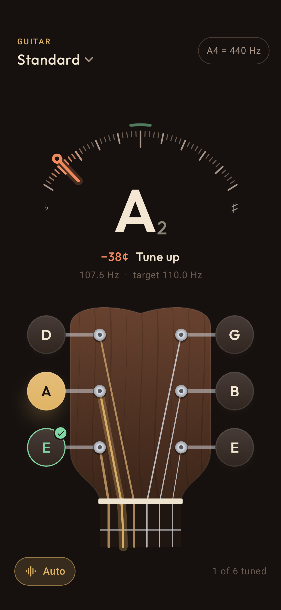
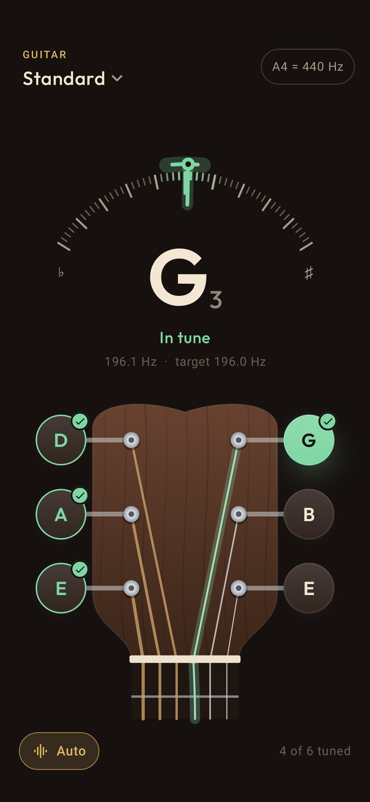
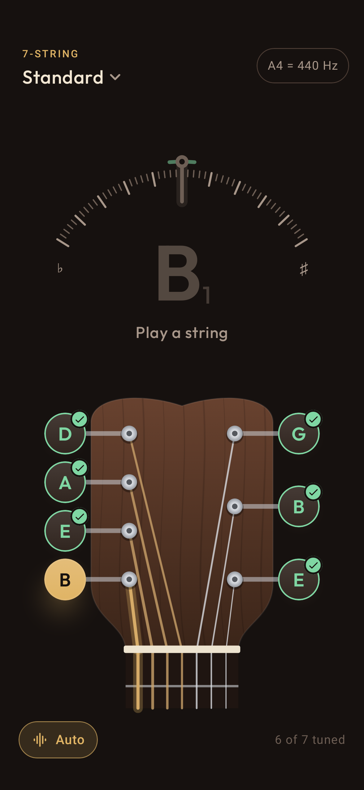

# Fretwise

A guitar tuner for Android that detects which string you're playing. The start of a guitar practice app.

<p>
  
  
  
</p>

- **Detection:** McLeod Pitch Method (normalized autocorrelation via FFT), with the period refined over several repetitions for sub-cent precision. Input is low-passed per instrument to cut mic hiss. See `audio/PitchDetector.kt`.
- **Stability:** adaptive noise gate, median + exponential smoothing, string auto-detection with hysteresis, and a string counts as tuned once it holds within ±4 cents for 0.3 s (the needle stays green until 6 cents off, so it doesn't flicker at the edge). See `TunerTracker.kt`.
- **Instruments:** guitar (11 tunings), 7-string, bass (4/5-string), ukulele, chromatic. Adjustable A4 reference.

```
./gradlew testDebugUnitTest          # detector accuracy + tracker tests
./gradlew recordRoborazziDebug       # renders docs/screenshots/
./gradlew assembleRelease            # app/build/outputs/apk/release/app-release.apk
```

## Debugging with real audio

Launch with `adb shell am start -n com.celestiallemon.tuner/.MainActivity --ez capture true` to save the raw mic
input to `/sdcard/Android/data/com.celestiallemon.tuner/files/capture.f32`, then pull it and replay it through the
pipeline: `CAPTURE=capture.f32 REPLAY_OUT=replay.txt ./gradlew testDebugUnitTest --tests '*CaptureReplayTest*'`.
